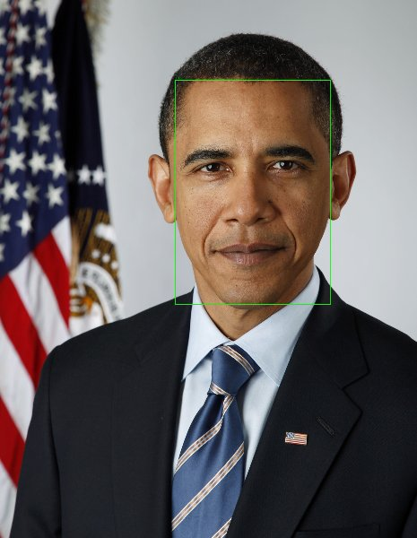

<div align="center">

# ⚡ Intel Iris Xe Inference Lab

### Hardware-Aware Deep Learning Inference Optimization with OpenVINO

**Benchmarking • Quantization • GPU Acceleration • Parallel Inference • Performance Engineering**

<br/>

[](https://www.python.org/)
[](https://docs.openvino.ai/)
[](https://www.intel.com/)
[](LICENSE)

<br/>

**Can an integrated GPU outperform a CPU?**

Not always. This project investigates when, why, and by how much different inference configurations outperform each other on real consumer hardware.

<br/>

[Explore Results](#-benchmark-results) •
[Installation](#-installation) •
[Run Experiments](#-running-the-experiments) •
[Roadmap](#-roadmap)

<br/>

</div>

---

## 🧠 Project Overview

Deep learning inference optimization is not simply about moving workloads from CPU to GPU.

Performance depends on several interacting factors:

- Model architecture
- Hardware capabilities
- Batch size
- Numerical precision
- Memory bandwidth
- Threading and concurrency
- Runtime implementation

This project builds a reproducible benchmarking and inference environment using **Intel OpenVINO** to investigate these factors on an Intel Iris Xe integrated GPU.

Rather than assuming GPU acceleration is always beneficial, the experiments compare actual execution performance across different configurations.

### 🎯 Research Objectives

| Area | Investigation |
|---|---|
| Hardware acceleration | Intel CPU vs Iris Xe GPU |
| Batch optimization | Batch sizes 1, 2, 4, 8 and 16 |
| Async inference | Multiple concurrent inference requests |
| Multiprocessing | Scaling inference across worker processes |
| Quantization | FP16 vs INT8 throughput **and accuracy** |
| Model architecture | Face Detection vs MobileNetV3 |
| Practical deployment | Batch image inference with bounding boxes |
| Performance analysis | Latency, throughput, P95, P99 and speedup |

---

## 🏆 Key Experimental Findings

The experiments revealed several interesting characteristics of integrated GPU inference.

<div align="center">

| 🚀 Metric | Experimental Result |
|---|---:|
| Best GPU speedup (face detection) | **2.32×** |
| Best GPU throughput (face detection) | **348 images/sec** |
| Best multiprocessing throughput | **375 images/sec** |
| Best INT8 CPU throughput (MobileNetV3) | **754 images/sec** |
| Best INT8 GPU throughput (MobileNetV3) | **541 images/sec** |
| INT8 accuracy cost (real calibration) | **−2.0 pts Top-1** |
| INT8 speedup vs FP16 (CPU, batch=8) | **2.28×** |

</div>

*Results are hardware-specific and represent the measured configurations in this project.*

### 🔥 Performance Highlights

**1. GPU acceleration is batch-dependent**

The face-detection model achieved approximately 2.32× GPU speedup at batch size 8.

**2. Multiprocessing improves aggregate throughput**

Four GPU worker processes achieved approximately 375 images/sec, outperforming the synchronous and asynchronous configurations.

**3. Model architecture changes the outcome**

MobileNetV3-Large performed better on CPU than GPU across all tested batch sizes.

**4. INT8 quantization delivers a strong speed/accuracy trade-off**

Real-calibration INT8 achieved **2.28× CPU throughput** at a cost of **2.0 percentage points** of Top-1 accuracy on MobileNetV3 (90.2% → 88.2%). Random calibration produced a faster but functionally broken model (4.6% Top-1) — a cautionary demonstration of why calibration data matters.

**5. Hardware-aware optimization matters**

The fastest configuration is determined by the combination of model architecture, precision, batch size and execution device.

---

## 💻 Hardware Environment

All experiments were conducted on a consumer laptop rather than a dedicated GPU workstation.

| Component | Specification |
|---|---|
| CPU | Intel Core i5-1135G7 |
| Generation | 11th Generation |
| CPU Configuration | 4 Cores / 8 Threads |
| GPU | Intel Iris Xe Graphics |
| GPU Architecture | Integrated Graphics |
| Available RAM | Approximately 7 GB |
| Operating System | Ubuntu 26.04 LTS (64-bit) |
| Desktop | XFCE 4.20 |
| Inference Engine | OpenVINO 2024.6.0 |
| Python | 3.12 |

### ⚙️ An Important Hardware Constraint

Unlike dedicated GPUs, Intel Iris Xe uses shared system memory.

This means the CPU and GPU compete for the same available RAM and memory bandwidth.

Consequently, GPU acceleration is not guaranteed to improve performance.

This hardware constraint makes the project particularly useful for understanding real-world inference optimization on resource-limited systems.

---

## 📊 Benchmark Results

### 1. CPU vs GPU — Face Detection

Model: `face-detection-retail-0004`

Input shape: `[N, 3, 300, 300]`

| Batch | CPU Latency | GPU Latency | CPU Throughput | GPU Throughput | GPU Speedup |
|---:|---:|---:|---:|---:|---:|
| 1 | 3.33 ms | 3.42 ms | 301 | 293 | 0.97× |
| 2 | 6.98 ms | 6.49 ms | 287 | 308 | 1.07× |
| 4 | 20.21 ms | 11.49 ms | 198 | 348 | **1.76×** |
| 8 | 57.50 ms | 24.76 ms | 139 | 323 | **2.32×** |
| 16 | 122.75 ms | 53.28 ms | 130 | 300 | **2.30×** |

*Throughput is measured in images/sec.*

**Observation:**

The GPU becomes substantially more effective as batch size increases.

The CPU experiences declining throughput at larger batch sizes, while the GPU maintains relatively stable throughput.

### 2. Parallel Inference — Throughput Scaling

Face-detection model, batch size 1.

| Execution Strategy | Workers | Throughput |
|---|---:|---:|
| Synchronous | 1 | 269–290 img/s |
| Asynchronous | 2 | 332 img/s |
| Asynchronous | 4 | 317 img/s |
| Asynchronous | 8 | 318 img/s |
| Multiprocessing | 2 | 339 img/s |
| Multiprocessing | 4 | **375 img/s** |
| Multiprocessing | 6 | 366 img/s |
| Multiprocessing | 8 | 364 img/s |

**Observation:**

Multiprocessing with four workers achieved the highest aggregate throughput.

Increasing the worker count beyond four did not provide additional benefits, suggesting that the system had reached its practical throughput limit.

### 3. Cross-Model Comparison — MobileNetV3-Large

Model: `mobilenet-v3-large-1.0-224-tf`

Input shape: `[N, 3, 224, 224]`

| Batch | CPU Throughput | GPU Throughput | GPU Speedup |
|---:|---:|---:|---:|
| 1 | 342 | 281 | 0.82× |
| 2 | 408 | 304 | 0.74× |
| 4 | 400 | 357 | 0.89× |
| 8 | 330 | 289 | 0.87× |
| 16 | 241 | 188 | 0.78× |

*Throughput is measured in images/sec.*

**Observation:**

Unlike face detection, MobileNetV3 performed better on CPU at every tested batch size.

This demonstrates why hardware acceleration must be evaluated against individual model architectures rather than assumed to provide universal improvements.

### 4. INT8 Quantization — Speed and Accuracy

MobileNetV3-Large was post-training quantized to INT8 using NNCF with **200 real calibration images** from the Imagenette training set. The FP16 baseline and both INT8 variants were evaluated on 500 validation images from the Imagenette validation set (10 classes mapped to their ImageNet-1k indices).

#### Accuracy

| Model | Top-1 | Top-5 | Δ Top-1 vs FP16 |
|---|---:|---:|---:|
| FP16 | **90.20%** | 98.00% | baseline |
| INT8 (real calibration) | **88.20%** | 96.40% | **−2.00 pts** |
| INT8 (random calibration) | **4.60%** | 9.40% | **−85.60 pts** |

#### Throughput (real-calibration INT8)

| Batch | FP16 CPU | INT8 CPU | CPU speedup | FP16 GPU | INT8 GPU | GPU speedup |
|---:|---:|---:|---:|---:|---:|---:|
| 1 | 342 | 462 | 1.35× | 281 | 179 | 0.64× |
| 2 | 409 | 575 | 1.41× | 304 | 269 | 0.88× |
| 4 | 400 | 690 | 1.73× | 357 | 410 | 1.15× |
| 8 | 330 | **754** | **2.28×** | 289 | 541 | 1.87× |

*Throughput in images/sec.*

**Key findings:**

- **Real-calibration INT8 preserves accuracy**: 90.2% → 88.2% Top-1 (−2.0 percentage points) while delivering a **2.28× CPU throughput speedup** at batch=8. This is an excellent production trade-off.
- **Random calibration destroys the model**: the same quantization procedure with random calibration tensors collapsed Top-1 accuracy from 90.2% to **4.6%** — barely above chance. The random-calibration model was *faster* (1,077 img/s) but produced meaningless predictions.
- **Calibration data is the critical variable** in post-training quantization. Throughput measured on a model that was never validated for accuracy is misleading.
- **CPU remains the winner for MobileNetV3 even under INT8**: the CPU is 1.4–2.6× faster than the GPU across all batch sizes, reinforcing the architectural finding from Section 3.

**Methodology note:** Calibration used 200 images from the Imagenette *training* set; accuracy was evaluated on 500 images from the Imagenette *validation* set. Input preprocessing: RGB, normalized to `[-1, 1]` via `(x − 127.5) / 127.5` — matching the Hugging Face IR model's expected contract. Full details in [`docs/precision-study.md`](docs/precision-study.md).

---

## 🖼️ Real-World Batch Image Inference

This repository also includes an actual inference application rather than relying exclusively on synthetic benchmark inputs.

`app/batch_inference.py` provides:

- Folder-based image ingestion.
- CPU and GPU inference.
- Configurable batch processing.
- Face detection using OpenVINO.
- Bounding-box extraction and visualization.
- Confidence threshold filtering.
- Annotated image generation.
- JSON inference reports.

### Example Detection

<div align="center">



*Face detection performed using OpenVINO on Intel Iris Xe GPU.*

</div>

### Run the Application

```bash
python3 app/batch_inference.py \
    --input test_images \
    --model model/face-detection-retail-0004.xml \
    --device GPU \
    --batch-size 4 \
    --output output
```

### Generated Outputs

```text
output/
├── annotated_images/
│   ├── face1.jpg
│   ├── face2.jpg
│   └── ...
└── report.json
```

The JSON report contains:

- Number of processed images.
- Total detections.
- Batch execution statistics.
- Mean batch latency.
- Overall throughput.
- Individual detection confidence scores.
- Normalized bounding-box coordinates.

---

## 🏗️ Project Architecture

```text
intel-iris-xe-inference-lab/
│
├── app/
│   └── batch_inference.py
│
├── assets/
│   └── example_detection.jpg
│
├── benchmarks/
│   ├── run_benchmark.py
│   ├── sweep.py
│   ├── parallel_benchmark.py
│   ├── quantize_model.py
│   ├── quantize_model_real.py
│   ├── evaluate_accuracy.py
│   ├── plot_results.py
│   ├── plot_parallel.py
│   └── compare_models.py
│
├── config/
│   └── benchmark_config.yaml
│
├── data/
│   ├── imagenette_to_imagenet.py
│   └── prepare_imagenette.py
│
├── docs/
│   ├── lessons-learned.md
│   └── precision-study.md
│
├── model/
│   └── OpenVINO IR models
│
├── tests/
│   └── pytest test suite
│
├── Makefile
├── requirements.txt
├── LICENSE
└── README.md
```

Generated benchmark results, downloaded model binaries, and datasets are kept outside version control.

## 🚀 Installation

### 1. Clone the Repository

```bash
git clone https://github.com/adnanphp/intel-iris-xe-inference-lab.git

cd intel-iris-xe-inference-lab
```

### 2. Create a Virtual Environment

```bash
python3 -m venv .venv

source .venv/bin/activate
```

### 3. Install Dependencies

```bash
pip install --upgrade pip

pip install -r requirements.txt
```

### 4. Verify OpenVINO Devices

```bash
python3 -c "import openvino as ov; print(ov.Core().available_devices)"
```

Expected output:

```text
['CPU', 'GPU']
```

The available devices depend on the installed Intel GPU driver and OpenVINO runtime configuration.

## 📦 Download Models

The OpenVINO IR model files (.xml and .bin) are not committed to the repository.

### Face Detection

```bash
cd model

wget https://storage.openvinotoolkit.org/repositories/open_model_zoo/2023.0/models_bin/1/face-detection-retail-0004/FP16/face-detection-retail-0004.xml

wget https://storage.openvinotoolkit.org/repositories/open_model_zoo/2023.0/models_bin/1/face-detection-retail-0004/FP16/face-detection-retail-0004.bin
```

### MobileNetV3-Large

```bash
wget https://huggingface.co/OpenVINO/mobilenet_v3_large-fp16-ov/resolve/main/mobilenet_v3_large.xml \
    -O mobilenet-v3-large-1.0-224-tf.xml

wget https://huggingface.co/OpenVINO/mobilenet_v3_large-fp16-ov/resolve/main/mobilenet_v3_large.bin \
    -O mobilenet-v3-large-1.0-224-tf.bin
```

Return to the repository root:

```bash
cd ..
```

## 📊 Dataset for Accuracy Evaluation

INT8 accuracy evaluation uses Imagenette (fast.ai's 10-class ImageNet subset).

```bash
mkdir -p data
cd data

wget https://s3.amazonaws.com/fast-ai-imageclas/imagenette2-160.tgz

tar xzf imagenette2-160.tgz

cd ..
```

```bash
# Prepare 200 calibration images + validation labels
python3 data/prepare_imagenette.py
```

This produces `data/calibration_images/` (200 PNGs) and `data/val_labels.txt` (~3,900 labeled validation entries).

Datasets are kept out of version control.

## 🧪 Running the Experiments

### Single Benchmark

```bash
python3 benchmarks/run_benchmark.py \
    --model model/face-detection-retail-0004.xml \
    --device GPU \
    --batch-size 8 \
    --iterations 50 \
    --input-shape 3,300,300 \
    --csv results/benchmark_results.csv
```

### Batch-Size Sweep

```bash
python3 benchmarks/sweep.py \
    --csv results/sweep_python.csv
```

### Asynchronous Inference

```bash
python3 benchmarks/parallel_benchmark.py \
    --model model/face-detection-retail-0004.xml \
    --device GPU \
    --mode async \
    --batch-size 1 \
    --iterations 100 \
    --workers 2
```

### Multiprocess Inference

```bash
python3 benchmarks/parallel_benchmark.py \
    --model model/face-detection-retail-0004.xml \
    --device GPU \
    --mode multiprocess \
    --batch-size 1 \
    --iterations 50 \
    --workers 4
```

### INT8 Quantization (Real Calibration)

```bash
python3 benchmarks/quantize_model_real.py \
    --model model/mobilenet-v3-large-1.0-224-tf.xml \
    --output model/mobilenet-v3-large-int8-real.xml \
    --calib-dir data/calibration_images \
    --calib-count 200
```

### Accuracy Evaluation

```bash
python3 benchmarks/evaluate_accuracy.py \
    --model model/mobilenet-v3-large-int8-real.xml \
    --labels data/val_labels.txt \
    --device CPU \
    --limit 500
```

### Generate Benchmark Visualizations

```bash
python3 benchmarks/plot_results.py results/sweep_python.csv

python3 benchmarks/plot_parallel.py results/parallel_results.csv

python3 benchmarks/compare_models.py
```

## 📈 Performance Visualizations

The benchmarking framework generates visualizations for comparing different execution configurations.

| Visualization | Purpose |
|---|---|
| latency.png | CPU/GPU latency comparison |
| throughput.png | Images processed per second |
| speedup.png | Relative GPU performance |
| parallel_throughput.png | Throughput under concurrency |
| parallel_latency.png | Latency under concurrency |
| model_comparison.png | Cross-model performance comparison |

Generated plots are stored in `results/plots/`.

## 🔬 Benchmark Methodology

To make performance comparisons meaningful, the experiments follow a consistent benchmarking procedure.

| Parameter | Configuration |
|---|---|
| Warm-up iterations | 10 |
| Timed iterations | 50 |
| Timing mechanism | `time.perf_counter()` |
| Input data | Synthetic float32 tensors |
| Execution devices | CPU and GPU |
| Batch sizes | 1, 2, 4, 8, 16 |
| Concurrency | Synchronous, asynchronous, multiprocessing |
| Performance metrics | Mean, median, standard deviation, P95, P99 |
| Throughput | Images per second |
| INT8 calibration | 200 real images (Imagenette training set) |
| INT8 accuracy evaluation | 500 Imagenette validation images |

### Measurement Considerations

Model compilation and initial execution are excluded through warm-up iterations.

Timing is measured per iteration.

Async execution uses multiple OpenVINO inference requests.

Multiprocessing uses the spawn method and a synchronization barrier.

CSV files preserve individual benchmark measurements for subsequent analysis.

### Limitations

The reported results should be interpreted within their experimental context.

Experiments were performed on one laptop.

Synthetic inputs exclude image loading and preprocessing overhead.

Thermal throttling and background processes may affect measurements.

Integrated graphics shares system memory with the CPU.

INT8 accuracy was measured on Imagenette (10 of the 1000 ImageNet classes) using 500 validation images. The absolute Top-1 numbers are therefore class-subset-specific; the FP16→INT8 delta is the meaningful result. Full ImageNet-1k validation was not run.

Results depend on the installed Intel GPU driver and OpenVINO version.

## 🧩 Engineering Lessons Learned

One particularly important debugging lesson came from the real-world face-detection application.

The initial implementation produced almost no detections despite using a working model and GPU.

The issue was not hardware acceleration.

It was preprocessing.

The model expected:

```text
Color format: BGR
Pixel range: 0–255
Tensor layout: NCHW
```

The original implementation supplied RGB images normalized to [0, 1].

After correcting the preprocessing pipeline to BGR with raw pixel values, the same image produced a detection confidence of 1.0.

**Lesson:** Model preprocessing requirements are part of the inference contract. Incorrect preprocessing can invalidate an otherwise correctly configured inference pipeline.

A second lesson came from the INT8 study: throughput on a model that was never validated for accuracy is not a result. Random-calibration INT8 ran faster than real-calibration INT8 and produced meaningless predictions. Accuracy evaluation is part of the benchmark, not an optional extra.

Additional findings and implementation notes are documented in:

`docs/lessons-learned.md`

`docs/precision-study.md`

## 🗺️ Roadmap

| Component | Status |
|---|---|
| OpenVINO runtime and Iris Xe validation | ✅ Completed |
| CPU vs GPU benchmarking | ✅ Completed |
| YAML-driven benchmark engine | ✅ Completed |
| Batch-size optimization | ✅ Completed |
| Async inference pipeline | ✅ Completed |
| Multiprocess scaling | ✅ Completed |
| Cross-model benchmarking | ✅ Completed |
| FP16 vs INT8 throughput experiments | ✅ Completed |
| Batch image inference application | ✅ Completed |
| Automated pytest suite | ✅ Implemented |
| Performance visualization | ✅ Implemented |
| Preprocessing documentation | ✅ Completed |
| Representative-data INT8 accuracy evaluation | ✅ Completed |
| FP32 vs FP16 vs INT8 accuracy comparison | 🔄 Planned |
| End-to-end pipeline profiling | 🔄 Planned |
| Additional OpenVINO model architectures | 🔄 Planned |
| Automated benchmark regression tracking | 🔄 Planned |

## 🛠️ Technology Stack

<div align="center">

| Category | Technologies |
|---|---|
| Programming | Python |
| Inference Runtime | OpenVINO |
| Hardware Acceleration | Intel Iris Xe |
| Quantization | NNCF |
| Numerical Computing | NumPy |
| Visualization | Matplotlib |
| Configuration | YAML |
| Testing | Pytest |
| Data Reporting | CSV, JSON |
| Development Environment | Ubuntu Linux |

</div>

## 🎓 What This Project Demonstrates

This project demonstrates practical experience in:

Deep learning inference optimization.

Hardware-aware performance engineering.

CPU and integrated GPU acceleration.

OpenVINO model deployment.

Dynamic batch-size optimization.

Asynchronous execution and multiprocessing.

Post-training quantization with accuracy-aware evaluation.

Model-specific performance analysis.

Benchmark design and reproducibility.

Real-world computer vision inference.

Automated testing and engineering documentation.

The central objective is to understand not only how to execute deep learning models, but also how to measure, diagnose and optimize their performance under real hardware constraints.

## 📜 License

This project is released under the MIT License.

<div align="center">

⭐ If you find this project useful, consider giving it a star!

Built with Python, OpenVINO and a genuine interest in hardware-aware AI engineering.

**Muhammad Adnan Shahzad**

Machine Learning & AI Engineer | ML Researcher | Computer Vision

[GitHub](https://github.com/adnanphp) · [LinkedIn](https://www.linkedin.com/in/adnanphy/)

</div>
